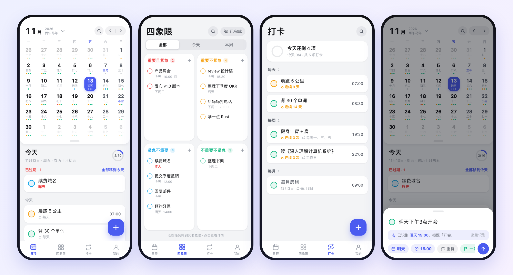
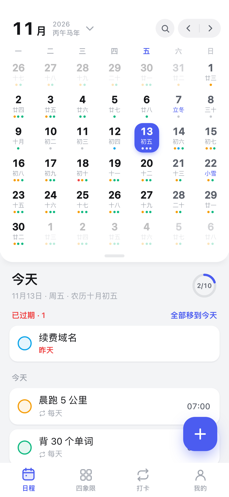
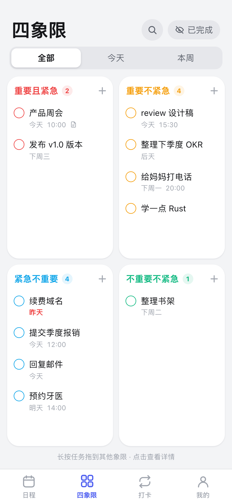
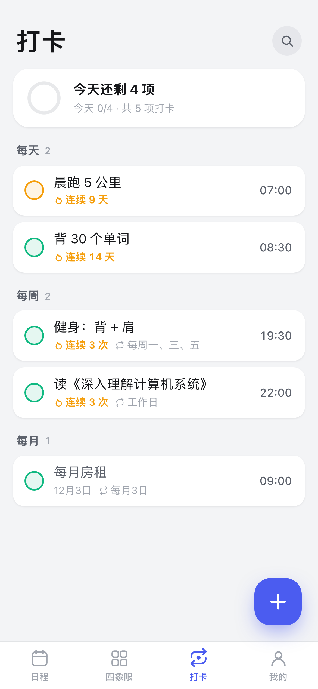
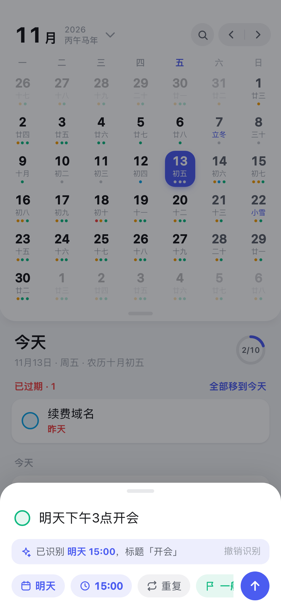

<div align="center">


# 可及清单 · Reach List

**A fast, beautiful daily planner for Android, built around a Chinese calendar and the Eisenhower matrix.**
<br>
**And your AI agent can read and manage your tasks, too.**

[](package.json)
[](#-install)
[](https://vuejs.org)
[](https://vite.dev)
[](https://capacitorjs.com)
[](#-let-your-ai-agent-manage-your-tasks)

[Features](#-features) · [Screenshots](#-screenshots) · [Install](#-install) · [Agent access](#-let-your-ai-agent-manage-your-tasks) · [Develop](#develop) · [简体中文](README.zh-CN.md)

<br>



</div>

<br>

## ✨ Why 可及清单

Most to-do apps are either too simple to plan with or too heavy to open every morning. 可及清单 (Reach List, formerly 每日计划) is built for the middle: **open it, see today, tap, done**. It is the first app in 可及 (Reach), a family of small tools that keep your data with you and can be driven by your own AI agents.

- 🗓️ **A calendar that fits how you actually live.** Lunar dates, solar terms, festivals and Chinese 休 / 班 public-holiday schedules are right there on the month view.
- 🧭 **Decide what matters.** Every task can be placed on a 2×2 Eisenhower matrix. Long-press and drag to re-prioritise.
- ⚡ **Type it like you'd say it.** `明天下午3点开会` becomes a task tomorrow at 15:00. `每周五晚上8点 羽毛球` becomes a weekly repeat.
- 🤖 **Agent-ready.** A tiny self-hosted sync server plus an installable skill lets Claude Code, Codex or Hermes read, add and complete your tasks.
- 🔒 **Your data stays yours.** Everything is stored on the phone. Sync is optional, self-hosted, and one JSON file.

## 🚀 Features

| | |
|---|---|
| **Month ⇄ week calendar** | Collapsible, finger-following swipes, colour dots for each quadrant, lunar calendar & official holiday / make-up-workday marks |
| **Eisenhower matrix** | Important × urgent quadrants, range filter (all / today / this week), long-press drag between quadrants |
| **Natural-language quick add** | Chinese date, time and repeat parsing, with a live "recognised as…" preview you can undo |
| **Flexible repeats** | Every N days / weeks / months / years, pick weekdays, optional end date; skip or complete a single occurrence |
| **打卡 (check-ins)** | All repeating tasks in one tab, grouped by rule, with a progress ring and 🔥 streak counters |
| **Subtasks** | Full tasks of their own: own date, time, reminder, quadrant and notes |
| **Reminders** | Local notifications for the next 30 days, including repeats, with exact alarms |
| **Gestures** | Swipe right to complete; swipe left to postpone, drop or delete; undo toast; haptics |
| **Search** | Across titles and notes, multiple terms must all match |
| **Dropped state** | Mark a task as "no longer planning to do" without deleting its history |
| **Backup & sync** | JSON export / import, plus optional sync to your own server |
| **Polished details** | Edge-to-edge UI; bottom sheets move frame by frame with the keyboard |

## 📸 Screenshots

<table>
  <tr>
    <td align="center"><br><sub><b>Calendar</b><br>lunar, holidays, agenda</sub></td>
    <td align="center"><br><sub><b>Eisenhower matrix</b><br>drag between quadrants</sub></td>
    <td align="center"><br><sub><b>打卡</b><br>streaks &amp; progress</sub></td>
    <td align="center"><br><sub><b>Quick add</b><br>natural-language input</sub></td>
  </tr>
</table>

<sub>Screenshots use demo data.</sub>

## 📲 Install

There is no store listing yet. Build the APK yourself (needs JDK 21 and the Android SDK):

```bash
git clone https://github.com/TonyWu2333/reachlist.git && cd reachlist
npm install
npm run apk              # debug APK  → android/app/build/outputs/apk/debug/
npm run install-apk      # adb install to the connected phone
```

For a signed release build see [Build & install on phone](#build--install-on-phone).

Just want to look around? `npm run dev` and open it in a phone-sized browser viewport.

## 🤖 Let your AI agent manage your tasks

```
phone app  ⇄  sync server (your server or this Mac)  ⇄  `planner` CLI + SKILL.md used by the agent
```

Ask things like *"what do I have today?"*, *"move the dentist to Friday"* or *"plan my week"*, and the agent edits the same tasks you see on your phone. Setup is three steps: run the server, paste the connection code on the phone, copy `skill/planner` into your agent's skills folder. Details in [Agent access](#agent-access-sync-server--skill).

## 🧱 Tech stack

Vue 3 · Vite · Capacitor 8 · `lunar-javascript` · a dependency-free Node sync server · a bundled CLI that reuses the app's own parsing and repeat logic.

---

## Develop

```bash
npm install
npm run dev          # http://localhost:5173 — use a phone-sized viewport
```

## Build & install on phone

```bash
npm run release          # signed release APK → android/app/build/outputs/apk/release/
npm run install-release  # adb install to the connected phone
npm run apk              # debug APK (debuggable WebView, for profiling via chrome://inspect)
```

Bump `version` in `package.json` before each release — it is the only place: Android's `versionName` is that string and
`versionCode` is derived from it (`major*10000 + minor*100 + patch`, e.g. 0.4.1 → 401), so every release installs over the
previous one and keeps its data. The app's "我的" page shows the same version.

Release signing reads `~/.android-keys/planner-release.properties` (override with `PLANNER_SIGNING=/path`),
which points at the keystore and holds its passwords. Neither is in the repo — back that folder up:
without the same key, a new build can't be installed over the old one.

Requires JDK 21 and an Android SDK (`android/local.properties` points at `~/Library/Android/sdk`).

The launcher icon is generated from `docs/brand/list-icon-source.png`: replace the image and run `python3 scripts/gen-icons.py` (uses only macOS `sips`). Design guidelines: [docs/DESIGN.md](docs/DESIGN.md).

## Layout

| Path | Purpose |
|---|---|
| `src/lib/storage.js` | The only place that knows where data lives (Capacitor Preferences → Android SharedPreferences; localStorage in the browser). |
| `src/lib/store.js` | Reactive task list + settings; debounced save of the whole JSON after any change; per-task change stamps for sync. |
| `src/lib/parse.js` | Chinese natural-language date/time parsing for quick add (`明天下午3点开会`, `每周五晚上8点 羽毛球`). |
| `src/lib/repeat.js` | Repeating tasks: one task + a rule (every N days / weeks / months / years, optional weekdays and end date), expanded per day; per-day `doneDates` / `skipDates`. |
| `src/lib/date.js` | Date helpers, lunar date / solar terms / festivals / 休·班 via `lunar-javascript`. |
| `src/lib/notify.js` | Local reminders: plans the next 30 days of notifications (incl. repeats) and re-syncs on every change; uses `USE_EXACT_ALARM`. |
| `src/lib/ui.js` | Haptics, toast with undo, Android back-button stack, keyboard height (from the native IME animation, see Android notes). |
| `src/views/CalendarView.vue` | Month ⇄ week collapsible calendar (transform-only animation, three persistent pages for finger-following swipes), agenda with overdue / done groups. |
| `src/views/QuadrantView.vue` | 2×2 matrix with range filter and long-press drag between quadrants. |
| `src/views/RoutineView.vue` | 打卡 tab: repeating tasks grouped by rule, with progress and streaks. |
| `src/views/MeView.vue` | Stats, display settings, backup export / import, sync settings. |
| `src/components/TaskRow.vue` | Task row: animated check, swipe right to complete, swipe left for postpone / drop / delete. |
| `src/components/SearchSheet.vue` | Search over titles and notes (space-separated terms, all must match). |
| `src/components/QuickAdd.vue`, `TaskDetail.vue` | Bottom sheets for creating and editing tasks (edits save live). |
| `scripts/gen-icons.py` | Builds the adaptive-icon foreground PNGs, legacy icons and status-bar icon from the source image. |

## Agent access (sync server + skill)

Agents such as Claude Code, Codex or Hermes can read and change the same tasks through a small self-hosted sync server:

```
phone app  ⇄  sync server (your server or this Mac)  ⇄  `planner` CLI + SKILL.md used by the agent
```

| Path | Purpose |
|---|---|
| `shared/merge.js` | Merge rule shared by app, server and CLI: per task, newer `updatedAt` wins; tombstones in `deleted` win over older edits. |
| `server/server.js` | Sync server: one JSON file behind a bearer token, `GET /api/state`, `POST /api/sync`, `GET /api/wait` (long poll). Node 18+, no dependencies. |
| `agent/cli.js` | `planner` CLI (today / list / search / add / done / skip / drop / edit / delete). Reuses the app's parsing and repeat logic. |
| `skill/planner/` | The installable skill: `SKILL.md`, bundled `scripts/planner.mjs` and `server/planner-server.mjs`. Rebuild with `npm run build:agent`. |
| `src/lib/sync.js` | App side: syncs on launch, resume, 2 s after a local change, and every minute in the foreground; a long poll in the foreground shows an agent's changes within a second or two. |

**Run the server** (on a machine both the phone and the agent can reach):

```bash
PLANNER_TOKEN=$(openssl rand -hex 24) PORT=18787 DATA_FILE=/var/lib/planner/data.json \
  node skill/planner/server/planner-server.mjs
```

It prints a connection code `http://host:18787#token`. On a public server, put it behind HTTPS (for example Caddy: `planner.example.com { reverse_proxy 127.0.0.1:18787 }`) and use `https://planner.example.com#token`; keep it running with systemd or pm2.

**Connect the phone:** 我的 → 同步与 Agent → turn on, paste the connection code.

**Give an agent the skill:** copy or symlink `skill/planner` into the agent's skills folder (for example `~/.claude/skills/planner` for Claude Code; Codex and Hermes read the same `SKILL.md` format from their own skills folders), then run `node <skill>/scripts/planner.mjs login '<code>'` once on that machine, or set `PLANNER_CODE`.

## Android notes

- `MainActivity` enables edge-to-edge; safe areas come from native `env(safe-area-inset-*)` (WebView ≥ 140), so `SystemBars.insetsHandling` is `disable` in `capacitor.config.json`.
- With insets handling disabled the WebView is not resized when the keyboard opens; bottom sheets move up by the keyboard height instead. `MainActivity` follows the system IME animation and passes the keyboard height to the page every frame, so sheets and keyboard move together.

## Data

Task shape: `{ id, title, note, date: 'YYYY-MM-DD' | '', time: 'HH:MM' | '', important, urgent, done, dropped, createdAt, doneAt, updatedAt, repeat, doneDates, skipDates, remind, parentId }` (`remind`: minutes before, `null` = off; `repeat`: rule string, see `src/lib/repeat.js`).
Data lives in app-private storage and is wiped on uninstall — export a backup regularly, or turn on sync.
