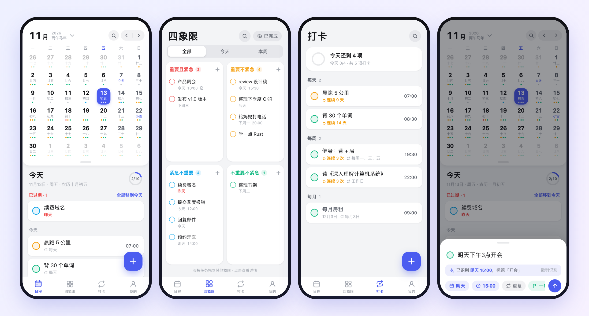
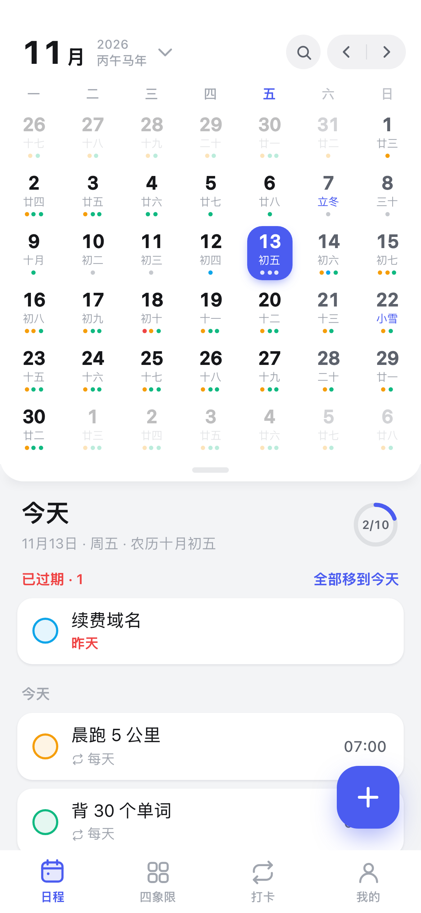
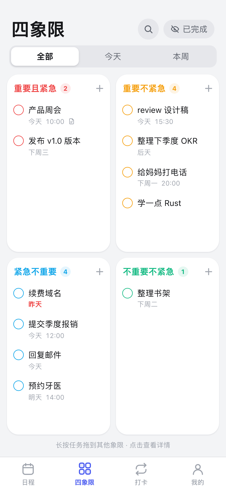
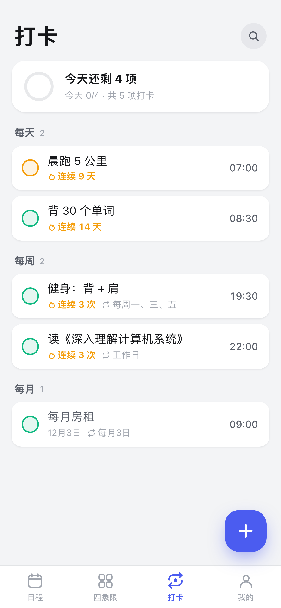
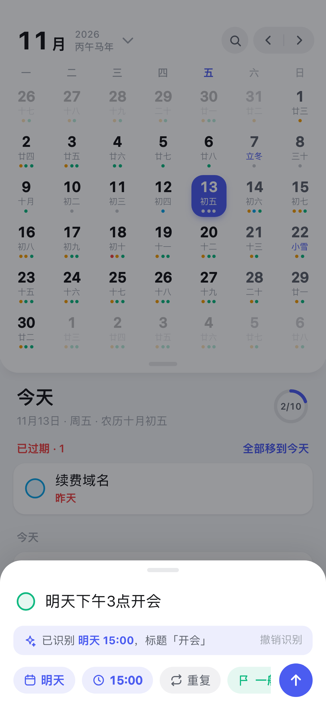

<div align="center">


# 可及清单

**轻快、好看的安卓日程应用：农历日历 + 四象限 + 打卡。**
<br>
**你的 AI agent 也能直接看和改你的任务。**

[](package.json)
[](#-安装)
[](https://vuejs.org)
[](https://vite.dev)
[](https://capacitorjs.com)
[](#-让-ai-agent-帮你管任务)

[功能](#-功能) · [截图](#-截图) · [安装](#-安装) · [Agent 接入](#-让-ai-agent-帮你管任务) · [开发](#开发) · [English](README.md)

<br>



</div>

<br>

## ✨ 为什么做可及清单

大多数待办 App 要么太简单，做不了计划；要么太重，每天早上都懒得打开。可及清单想做中间那一档：**打开、看今天、点一下、完事**。

它是「可及」系列工具的第一款（原名「每日计划」）。这个系列的每个工具都能独立使用，数据留在你自己手里，也都能让你的 AI agent 通过 skill 来操作。

- 🗓️ **贴合国内生活的日历。** 月视图上直接显示农历、节气、节日，以及法定节假日的「休」和调休的「班」。
- 🧭 **分清轻重缓急。** 每个任务都能放进「重要 × 紧急」四象限，长按拖动就能调整优先级。
- ⚡ **怎么说就怎么记。** 输入 `明天下午3点开会`，就是明天 15:00 的任务；`每周五晚上8点 羽毛球` 就是每周重复。
- 🤖 **Agent 可用。** 一个很小的自建同步服务器加一个可安装的 skill，Claude Code、Codex、Hermes 就能读取、添加和完成你的任务。
- 🔒 **数据是你的。** 全部存在手机里；同步是可选的，服务器自己搭，数据就是一个 JSON 文件。

## 🚀 功能

| | |
|---|---|
| **月 ⇄ 周日历** | 可折叠，跟手滑动；每天用彩色小点标出各象限的任务；农历、法定节假日和调休标记 |
| **四象限** | 重要 × 紧急四个象限，可按全部 / 今天 / 本周筛选，长按拖到其他象限 |
| **一句话添加** | 识别中文日期、时间和重复规则，实时显示「识别为……」，不对可以一键撤销 |
| **灵活的重复** | 每 N 天 / 周 / 月 / 年，可选星期几，可设结束日期；单次可以跳过或单独完成 |
| **打卡** | 所有重复任务集中在一个页面，按规则分组，带进度环和 🔥 连续天数 |
| **子任务** | 子任务也是完整的任务：有自己的日期、时间、提醒、象限和备注 |
| **提醒** | 本地通知，提前排好未来 30 天（含重复任务），使用精确闹钟 |
| **手势** | 右滑完成；左滑推迟、放弃或删除；可撤销的提示；触感反馈 |
| **搜索** | 搜索标题和备注，多个关键词需同时命中 |
| **放弃** | 把任务标记为「不打算做了」，不删除，保留记录 |
| **备份与同步** | 导出 / 导入 JSON，也可以同步到你自己的服务器 |
| **细节打磨** | 全面屏沉浸式界面；底部弹窗和键盘动画逐帧同步 |

## 📸 截图

<table>
  <tr>
    <td align="center"><br><sub><b>日历</b><br>农历、节假日、日程</sub></td>
    <td align="center"><br><sub><b>四象限</b><br>在象限之间拖动</sub></td>
    <td align="center"><br><sub><b>打卡</b><br>连续天数与进度</sub></td>
    <td align="center"><br><sub><b>快速添加</b><br>自然语言输入</sub></td>
  </tr>
</table>

<sub>截图使用的是演示数据。</sub>

## 📲 安装

暂时没有上架应用商店，需要自己构建 APK（需要 JDK 21 和 Android SDK）：

```bash
git clone https://github.com/TonyWu2333/reachlist.git && cd reachlist
npm install
npm run apk              # 调试版 APK → android/app/build/outputs/apk/debug/
npm run install-apk      # 用 adb 安装到已连接的手机
```

签名的正式版见 [构建并安装到手机](#构建并安装到手机)。

只想看看效果？运行 `npm run dev`，在浏览器里用手机尺寸打开。

## 🤖 让 AI agent 帮你管任务

```
手机 App  ⇄  同步服务器（你的服务器或这台电脑）  ⇄  agent 使用的 planner 命令行 + SKILL.md
```

你可以问 agent「我今天有什么事」「把看牙医挪到周五」「帮我排一下这周」，它改的就是你手机上看到的那些任务。配置只要三步：运行服务器，在手机上粘贴连接码，把 `skill/planner` 放进 agent 的 skills 文件夹。详见 [Agent 接入（同步服务器 + skill）](#agent-接入同步服务器--skill)。

## 🧱 技术栈

Vue 3 · Vite · Capacitor 8 · `lunar-javascript` · 无依赖的 Node 同步服务器 · 打包好的命令行工具（复用 App 自己的解析和重复规则逻辑）。

---

## 开发

```bash
npm install
npm run dev          # http://localhost:5173，用手机尺寸的窗口查看
```

## 构建并安装到手机

```bash
npm run release          # 签名的正式版 APK → android/app/build/outputs/apk/release/
npm run install-release  # 用 adb 安装到已连接的手机
npm run apk              # 调试版 APK（WebView 可调试，可以用 chrome://inspect 分析性能）
```

每次发版前修改 `package.json` 里的 `version`，只改这一处就够了：安卓的 `versionName` 就是这个字符串，`versionCode` 由它推算（`主版本*10000 + 次版本*100 + 修订号`，比如 0.4.1 → 401），所以每个新版本都能覆盖安装、保留数据。「我的」页面显示的也是这个版本号。

正式版签名读取 `~/.android-keys/planner-release.properties`（可以用 `PLANNER_SIGNING=/路径` 指定别的文件），里面写着 keystore 的位置和密码。这两样都不在仓库里，请备份好那个文件夹：换了签名密钥，新版本就没法覆盖安装旧版本。

需要 JDK 21 和 Android SDK（`android/local.properties` 指向 `~/Library/Android/sdk`）。

应用图标由 `docs/brand/list-icon-source.png` 生成：换图后运行 `python3 scripts/gen-icons.py`（只用到 macOS 自带的 `sips`）。设计规范见 [docs/DESIGN.md](docs/DESIGN.md)。

## 代码结构

| 路径 | 作用 |
|---|---|
| `src/lib/storage.js` | 唯一知道数据存在哪里的地方（手机上是 Capacitor Preferences → 安卓 SharedPreferences；浏览器里是 localStorage）。 |
| `src/lib/store.js` | 响应式的任务列表和设置；有改动时防抖保存整份 JSON，并记录每个任务的修改时间供同步使用。 |
| `src/lib/parse.js` | 快速添加用的中文自然语言解析：日期、时间、重复规则（`明天下午3点开会`、`每周五晚上8点 羽毛球`）。 |
| `src/lib/repeat.js` | 重复任务：一个任务 + 一条规则（每 N 天 / 周 / 月 / 年，可选星期几和结束日期），按天展开；每天的完成和跳过记在 `doneDates` / `skipDates`。 |
| `src/lib/date.js` | 日期工具；通过 `lunar-javascript` 提供农历、节气、节日和「休 / 班」。 |
| `src/lib/notify.js` | 本地提醒：排好未来 30 天的通知（含重复任务），每次改动后重新同步；使用 `USE_EXACT_ALARM`。 |
| `src/lib/ui.js` | 触感反馈、可撤销提示、安卓返回键栈、键盘高度（来自原生的输入法动画，见下文「安卓说明」）。 |
| `src/views/CalendarView.vue` | 可折叠的月 ⇄ 周日历（只用 transform 做动画，常驻三页实现跟手滑动），以及含「已过期 / 已完成」分组的日程。 |
| `src/views/QuadrantView.vue` | 四象限，可按范围筛选，长按在象限之间拖动。 |
| `src/views/RoutineView.vue` | 打卡页：重复任务按规则分组，显示进度和连续天数。 |
| `src/views/MeView.vue` | 统计、显示设置、备份导出 / 导入、同步设置。 |
| `src/components/TaskRow.vue` | 任务行：带动画的勾选，右滑完成，左滑推迟 / 放弃 / 删除。 |
| `src/components/SearchSheet.vue` | 搜索标题和备注（空格分隔多个关键词，需全部命中）。 |
| `src/components/QuickAdd.vue`、`TaskDetail.vue` | 新建和编辑任务的底部弹窗（编辑实时保存）。 |
| `scripts/gen-icons.py` | 根据原图生成自适应图标的前景 PNG、旧版图标和通知栏小图标。 |

## Agent 接入（同步服务器 + skill）

Claude Code、Codex、Hermes 等 agent 可以通过一个自建的小型同步服务器，读写和你手机上同一份任务：

```
手机 App  ⇄  同步服务器（你的服务器或这台电脑）  ⇄  agent 使用的 planner 命令行 + SKILL.md
```

| 路径 | 作用 |
|---|---|
| `shared/merge.js` | App、服务器和命令行共用的合并规则：按任务比较，`updatedAt` 新的那份胜出；`deleted` 里的删除记录会覆盖比它更早的修改。 |
| `server/server.js` | 同步服务器：一个 JSON 文件，用 Bearer 令牌保护；`GET /api/state`、`POST /api/sync`、`GET /api/wait`（长轮询，有变化立刻返回）。Node 18+，无依赖。 |
| `agent/cli.js` | `planner` 命令行（today / list / search / add / done / skip / drop / edit / delete），复用 App 的解析和重复规则逻辑。 |
| `skill/planner/` | 可安装的 skill：`SKILL.md`，以及打包好的 `scripts/planner.mjs` 和 `server/planner-server.mjs`。用 `npm run build:agent` 重新打包。 |
| `src/lib/sync.js` | App 端：启动、回到前台、本地改动 2 秒后、前台每分钟各同步一次；前台时挂着长轮询，agent 一改，手机一两秒内就能看到。 |

**运行服务器**（放在手机和 agent 都能访问到的机器上）：

```bash
PLANNER_TOKEN=$(openssl rand -hex 24) PORT=18787 DATA_FILE=/var/lib/planner/data.json \
  node skill/planner/server/planner-server.mjs
```

启动后会打印连接码 `http://主机:18787#令牌`。如果放在公网服务器上，请在前面加 HTTPS（比如 Caddy：`planner.example.com { reverse_proxy 127.0.0.1:18787 }`），连接码改用 `https://planner.example.com#令牌`，并用 systemd 或 pm2 让它常驻。不在同一个局域网时，也可以用 Tailscale 让手机和服务器互通。

**连接手机：** 我的 → 同步与 Agent → 打开开关，粘贴连接码。

**给 agent 装 skill：** 把 `skill/planner` 复制或软链接到 agent 的 skills 文件夹（Claude Code 是 `~/.claude/skills/planner`；Codex 和 Hermes 也从各自的 skills 文件夹读取同样格式的 `SKILL.md`），然后在那台机器上运行一次 `node <skill目录>/scripts/planner.mjs login '<连接码>'`，或者设置环境变量 `PLANNER_CODE`。

## 安卓说明

- `MainActivity` 开启了全面屏沉浸（edge-to-edge）；安全区域来自原生的 `env(safe-area-inset-*)`（WebView ≥ 140），所以 `capacitor.config.json` 里的 `SystemBars.insetsHandling` 设为 `disable`。
- 因为关掉了 insets 处理，弹出键盘时 WebView 不会缩小；底部弹窗改为按键盘高度上移。`MainActivity` 监听系统的输入法动画，每一帧把键盘高度传给网页，所以弹窗和键盘是同步移动的。

## 数据

任务结构：`{ id, title, note, date: 'YYYY-MM-DD' | '', time: 'HH:MM' | '', important, urgent, done, dropped, createdAt, doneAt, updatedAt, repeat, doneDates, skipDates, remind, parentId }`（`remind`：提前多少分钟提醒，`null` 表示关闭；`repeat`：重复规则字符串，见 `src/lib/repeat.js`）。

数据存在应用私有目录里，卸载 App 会一起删除。请定期导出备份，或者打开同步。
